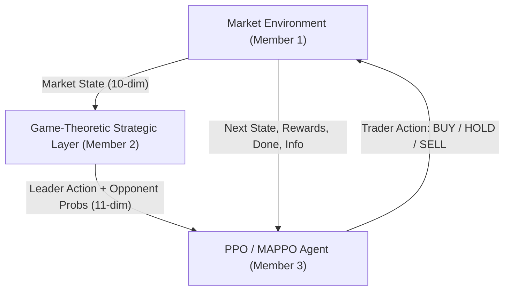

# Game-Theoretic Multi-Agent Reinforcement Learning for Strategic Trading

A research-grade algorithmic trading framework integrating **Artificial Financial Market Simulation**, **Stackelberg Game Theory**, **Statistical Opponent Modeling**, and **Deep Multi-Agent Reinforcement Learning (PPO/MAPPO)** with a live FastAPI backend and React/Vite dashboard.

---

## 1. System Architecture

The framework couples three distinct research subsystems into a unified sequential decision loop:



1. **Artificial Financial Market Engine (Member 1)**:
   - Microstructure dynamics with order execution, bid/ask quotes, price dynamics, and liquidity depletion.
   - Cash and portfolio mark-to-market accounting with explicit transaction costs and market impact.
   - Heuristic baseline trading agents: `MomentumAgent` and `ValueAgent`.

2. **Game-Theoretic Strategic Layer (Member 2)**:
   - Two-stage Stackelberg game where a strategic market maker leader chooses liquidity/spread policies (`TIGHT`, `MEDIUM`, `WIDE`).
   - Statistical opponent modeling with Laplace smoothing over discretized market states.
   - Quantal Response Equilibrium (QRE) combining empirical opponent action probabilities with follower utilities.
   - 11-dimensional `StrategicObservation` feature vector generation.

3. **Reinforcement Learning Subsystem (Member 3)**:
   - Production-grade Proximal Policy Optimization (PPO) agent consuming a unified 21-dimensional state space (10 market features + 11 strategic features).
   - Centralized Training with Decentralized Execution (CTDE) architecture with `CentralizedCritic` for multi-agent trading (MAPPO).
   - Generalized Advantage Estimation (GAE-$\lambda$) with normalized advantages and orthogonal network initialization.
   - Evaluation harness ensuring 100% training/evaluation parity and frozen opponent model evaluation.
   - Checkpoint serialization and state-dimension validation.

---

## 2. Repository Layout

```
strategic-market-simulation/
├── backend/                  # FastAPI WebSocket & REST simulation service
│   ├── main.py               # API routes, CORS, and WebSocket endpoints
│   ├── schemas.py            # Pydantic request/response schemas
│   ├── simulation_service.py # Real-time simulation step orchestrator
│   └── training_service.py   # Background RL training service
├── frontend/                 # Interactive React + TypeScript + Vite Dashboard
│   ├── src/components/       # Real-time charts, Stackelberg visualizer, multi-agent panels
│   ├── src/pages/            # Dashboard, Training, and Experiments views
│   └── src/api/              # REST client and WebSocket hooks
├── environment/              # Member-1 Market Simulation Engine
│   ├── market_env.py         # Gymnasium-compatible MarketEnvironment
│   ├── price_model.py        # Price impact, fundamental reversion, and noise
│   ├── order_manager.py      # BUY/HOLD/SELL normalization and validation
│   ├── execution_engine.py   # Trade execution and portfolio updating
│   ├── liquidity.py          # Liquidity depletion and spread widening
│   ├── portfolio.py          # Mark-to-market valuation, cash, and inventory
│   └── config.py             # Market configuration dataclass
├── game_theory/              # Member-2 Strategic Game-Theoretic Layer
│   ├── stackelberg.py        # Leader-follower Stackelberg game solver
│   ├── opponent_model.py     # Discretized state opponent transition tracker
│   ├── strategic_layer.py    # StrategicObservation generator
│   └── utility.py            # Follower utility & QRE calculations
├── rl/                       # Member-3 RL/MARL Subsystem
│   ├── ppo_agent.py          # PPO agent with GAE, clipped loss, and entropy bonus
│   ├── marl.py               # MAPPO controller with CTDE architecture
│   ├── policy.py             # Modular PolicyNetwork with LayerNorm & Orthogonal init
│   ├── critic.py             # CentralizedCritic for multi-agent global state
│   ├── rollout_buffer.py     # Trajectory buffer with GAE-lambda advantage computation
│   ├── state_encoder.py      # Scale-invariant normalizer with running statistics
│   ├── action_space.py       # Discrete action converter (0: HOLD, 1: BUY, 2: SELL)
│   ├── trainer.py            # Training loop with periodic evaluation & checkpointing
│   ├── evaluator.py          # Financial metrics evaluator (Sharpe, Max DD, Win Rate)
│   └── checkpoint.py         # Checkpoint manager with weights & metadata serialization
├── agents/                   # Agent wrappers (momentum, value, rl_trader, market_maker)
├── experiments/              # Experiment scripts (single_rl, marl, stackelberg, baselines)
└── tests/                    # Comprehensive unit, integration, and audit tests
```

---

## 3. Quickstart & Installation

### 3.1 Backend & Python Environment Setup

Clone the repository and set up a virtual environment:

```bash
# Clone the repository
git clone https://github.com/Suprajakshaya116/strategic-market-simulation.git
cd strategic-market-simulation

# Create and activate virtual environment
python -m venv .venv
# On Windows:
.venv\Scripts\Activate.ps1
# On macOS/Linux:
source .venv/bin/activate

# Install Python dependencies in editable mode
pip install -r requirements.txt
pip install -e .
```

### 3.2 Frontend Setup

Install the Node.js dependencies for the web dashboard:

```bash
cd frontend
npm install
cd ..
```

---

## 4. Running the Application

### 4.1 Launch Interactive Web Dashboard & Live API

Start both the FastAPI backend and Vite frontend:

**Terminal 1 — Backend (FastAPI):**
```bash
python -m uvicorn backend.main:app --host 127.0.0.1 --port 8000 --reload
```

**Terminal 2 — Frontend (Vite + React):**
```bash
cd frontend
npm run dev
```

- **Interactive UI Dashboard**: [http://localhost:5173/](http://localhost:5173/)
- **FastAPI Interactive Docs (Swagger)**: [http://127.0.0.1:8000/docs](http://127.0.0.1:8000/docs)
- **API Health Endpoint**: [http://127.0.0.1:8000/api/health](http://127.0.0.1:8000/api/health)

---

## 5. Experiments & Validation

### 5.1 Run Full Test Suite
Executes all unit, integration, and regression tests:
```bash
pytest tests/
```

### 5.2 Run End-to-End Pipeline Demonstration
Runs a live simulation exercising all three members simultaneously (market engine, leader decisions, opponent updates, RL action selection, and PPO optimization):
```bash
python examples/end_to_end_example.py
```

### 5.3 Run Controlled Multi-Seed Experiments
Runs matched ablation experiments across 4 variants (`rl_only`, `stackelberg_only`, `opponent_model_only`, `proposed_full`) across 3 random seeds, recording metrics to CSV and JSON:
```bash
python experiments/run_controlled_experiments.py --seeds 42 100 2026 --timesteps 1000 --eval_episodes 5
```

### 5.4 Individual Experiment Scripts
```bash
# Single-Agent PPO against rule-based baselines
python experiments/single_rl.py

# Multi-Agent PPO (MAPPO) with Centralized Critic (CTDE)
python experiments/marl.py

# Stackelberg Strategic MARL integration
python experiments/stackelberg_marl.py

# Rule-based Baseline Simulation
python experiments/baseline_rule.py
```

---

## 6. Integration Contract & State Schema

### State Vector Representation (21 Dimensions)
The PPO agent receives a concatenated 21-dimensional normalized vector:

- **10 Market Dynamics Features**:
  1. Relative Mispricing: `(price - fundamental_value) / fundamental_value`
  2. Return: `(price - previous_price) / previous_price`
  3. Scaled Volume: `volume / 100.0`
  4. Relative Spread: `spread / initial_spread`
  5. Liquidity Level: `liquidity`
  6. Volatility Level: `volatility`
  7. Order Imbalance: `(buy_volume - sell_volume) / (buy_volume + sell_volume + eps)`
  8. Normalized Inventory: `inventory / max_order_size`
  9. Normalized Cash Ratio: `(cash - initial_cash) / initial_cash`
  10. Normalized Price Deviation: `(price - initial_price) / initial_price`

- **11 Strategic Features (Stackelberg Game Theory Layer)**:
  - Leader Action (3-dim one-hot: `TIGHT`, `MEDIUM`, `WIDE`)
  - Opponent Action Probabilities (3-dim: $P(\text{HOLD})$, $P(\text{BUY})$, $P(\text{SELL})$)
  - Leader Expected Spread (1-dim)
  - Follower Utility Expectations (3-dim)
  - Discretized Market State Index (1-dim)

### Action Space
Discrete action space supporting standard and position-sized orders:
- `0`: `"HOLD"`
- `1`: `"BUY"` (or `("BUY", quantity)`)
- `2`: `"SELL"` (or `("SELL", quantity)`)

### Reward Formulation
$$R_i = \Delta V_i - \lambda_{\text{risk}} |\text{inventory}| \cdot \sigma - c_{\text{tx}} \cdot \text{Cost}_i - \eta_{\text{impact}} \cdot \text{Impact}_i$$

---

## 7. Empirical Findings Summary

Controlled multi-seed benchmark experiments demonstrate:
- **Spread Regulation**: In uncontrolled baselines (`rl_only`), aggressive order imbalance triggers severe spread divergence ($> 1000.0$). The proposed Stackelberg strategic leader regulates spreads to $2.10 \pm 1.20$.
- **Downside Risk Protection**: Strategic market-control prevents severe adverse selection and account drawdowns (preventing the $-84.77\%$ drawdown observed in unconstrained `rl_only`).
- **Complete Parity**: Training and evaluation employ identical state encoders, strategic features, and execution timing.

For detailed theoretical derivations, tables, and audit logs, see:
- [`INTEGRATION_AUDIT.md`](./INTEGRATION_AUDIT.md)
- [`RESEARCH_VALIDATION.md`](./RESEARCH_VALIDATION.md)
